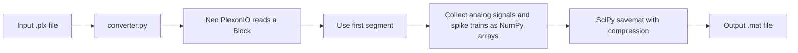

# PLX to MATLAB Converter

A small Python script for converting Plexon `.plx` electrophysiology recordings into compressed MATLAB `.mat` files. It uses Neo to read the Plexon file and SciPy to write the extracted data.

This project addresses one specific need: making selected analog signals and spike times from a PLX recording available in MATLAB. It is not a replacement for the Plexon software suite.

## Motivation

This project began with a practical problem in a university research laboratory. A graduate student needed to convert `.plx` files containing EEG recordings from epileptic rats in *in vivo* experiments. The data were intended for research into the relationship between circadian cycles and epileptic activity.

The conversion process depended on proprietary Plexon software licensed on a single, very old university computer. That made a routine research task dependent on one specific machine. In a discussion about the problem, we realized that this particular conversion could be handled with Python and freely available libraries.

I developed this project with Neo, NumPy, and SciPy to provide an accessible way to perform that conversion and reduce dependence on that computer. Its scope is deliberately specific: it converts selected data from a PLX file to a MAT file; it does not provide the broader analysis or acquisition features of Plexon software.

## Features

- Reads Plexon `.plx` recordings through Neo's `PlexonIO` reader.
- Extracts analog signals and spike trains from the first segment returned by Neo.
- Stores extracted values in a MATLAB `.mat` file using SciPy, with compression enabled.
- Writes analog signal arrays with generated `AD` names and associated start-time, index, and sampling-period fields.
- Writes spike-time arrays as column vectors with generated `sigNNNi` names.

## Technologies

| Technology | Role |
| --- | --- |
| Python | Runs the conversion script. |
| [Neo](https://neo.readthedocs.io/) | Reads the Plexon recording and exposes its segments, analog signals, and spike trains. |
| [NumPy](https://numpy.org/) | Converts extracted signal and spike data to arrays for output. |
| [SciPy](https://scipy.org/) | Writes the MATLAB `.mat` file with `scipy.io.savemat`. |

## Requirements

The dependency constraints declared in `requirements.txt` are:

| Package | Required version |
| --- | --- |
| `neo` | `>=0.10.0` |
| `scipy` | `>=1.7.0` |
| `numpy` | `>=1.20.0` |

The repository does not declare a minimum Python version. The examples below use Python 3 and `python3` commands.

## Installation

Clone the repository and enter its directory:

```bash
git clone https://github.com/franciscomarcon/plx-to-matlab.git
cd plx-to-matlab
```

Create and activate a virtual environment, then install the dependencies:

```bash
python3 -m venv .venv
source .venv/bin/activate
python -m pip install -r requirements.txt
```

On Windows, activate the environment with:

```powershell
.venv\Scripts\Activate.ps1
```

## Usage

The current script does not define command-line options. Set the input and output paths in the two variables at the bottom of `converter.py`, then run the script from the repository directory.

For example, change those lines to:

```python
plx_file = "/path/to/recording.plx"
mat_file = "/path/to/recording.mat"
```

Then run:

```bash
python converter.py
```

The output directory must already exist. On success, the script prints a message containing the output path. The generated MAT file contains the variables described in [Implementation overview](#implementation-overview). There are no `--input` or `--output` flags in the current implementation.

## Implementation overview

`convert_plx_to_mat(plx_file, mat_file)` creates a `neo.io.PlexonIO` reader and calls `read_block()`. It takes analog signals and spike trains from `block.segments[0]`, places their NumPy arrays and selected timing fields in a dictionary, and passes that dictionary to `scipy.io.savemat` with `do_compression=True`.

The generated MAT variables are:

| Data | Variable names and contents |
| --- | --- |
| Analog signals | `AD02`, `AD03`, and so on, generated from each iterated channel. Each variable contains the channel samples. |
| Analog timing | `<AD name>_ts` stores the first signal time; `<AD name>_ind` stores the integer value `1`; `<AD name>_ts_step` stores the signal sampling period. |
| Spike trains | `sig001i`, `sig002i`, and so on, generated in iteration order. Each variable is a column of spike times. |

These names are generated by the script; the code does not preserve original Plexon channel or unit labels in the output variables.



## Project structure

```text
plx-to-matlab/
├── converter.py       # Conversion function and configured input/output paths
├── requirements.txt   # Neo, SciPy, and NumPy dependencies
├── README.md          # Project documentation
├── .gitignore         # Ignores data files and local environment artifacts
└── LICENSE            # MIT License
```

## Limitations

- The script processes only `block.segments[0]`; it does not iterate over additional segments.
- It exports analog signals and spike trains only. The current code does not export events, other metadata, or annotations.
- The output names are generated by iteration order. The script does not retain source channel or unit labels, and repeated generated analog names can overwrite earlier values in the output dictionary.
- Input and output paths are set in the script. There is no command-line interface, path validation, or batch conversion workflow.
- The script assumes the file can be read by Neo's Plexon reader and that the returned block has a first segment. Error handling for unsupported or malformed files is not implemented.

## Credits and acknowledgments

The project uses [Neo](https://neo.readthedocs.io/) to read electrophysiology data and NumPy and SciPy to prepare and write the output. The project grew from a conversion need in a university neuroscience research setting; no individual researcher or unpublished research data are identified here.

## License

This project is distributed under the MIT License. See [`LICENSE`](LICENSE) for the full text.
